# BidPro — Bid Management System

A modern, frontend-only bid management workspace for discovering auctions, placing strategic bids, automating limits, tracking position changes, and turning bidding activity into clear reports and analytics.

Built with **HTML5, CSS3, and vanilla JavaScript** — no backend, no database, no build step. All data is simulated and stored in the browser using `localStorage`.

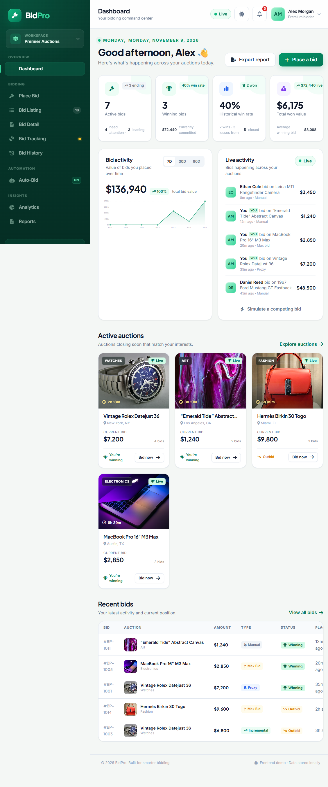

---

## Table of contents

- [Quick start](#quick-start)
- [Demo credentials](#demo-credentials)
- [Screenshots](#screenshots)
- [Features](#features)
- [Tech stack](#tech-stack)
- [Project structure](#project-structure)
- [How it works](#how-it-works)
- [Data model](#data-model)
- [Design system](#design-system)
- [Responsive behaviour](#responsive-behaviour)
- [Accessibility](#accessibility)
- [Browser support](#browser-support)
- [Deployment](#deployment)
- [Submission checklist](#submission-checklist)
- [Limitations & notes](#limitations--notes)

---

## Quick start

No installation or build tools are required.

### Option 1 — Open the file directly

Double-click `index.html`, or open it in any modern browser.

### Option 2 — Serve locally (recommended)

Some browsers restrict storage or downloads on `file://` URLs, so a local server is recommended:

```bash
# Python 3
python -m http.server 8000

# or Node.js
npx serve .
```

Then visit <http://localhost:8000>.

> An internet connection is used to load the Google Fonts and Font Awesome icon stylesheets. Auction imagery is stored locally in `assets/images/`.

---

## Demo credentials

| Field    | Value              |
| -------- | ------------------ |
| Email    | `alex@bidpro.demo` |
| Password | `demo123`          |

On the sign-in screen you can also press **“Explore the demo workspace”** to enter instantly.

New accounts can be created from the **Create account** tab. Registration validates name, email, password length, confirmation, and terms acceptance.

---

## Screenshots

| Page | Preview |
| ---- | ------- |
| Dashboard |  |
| Place Bid | 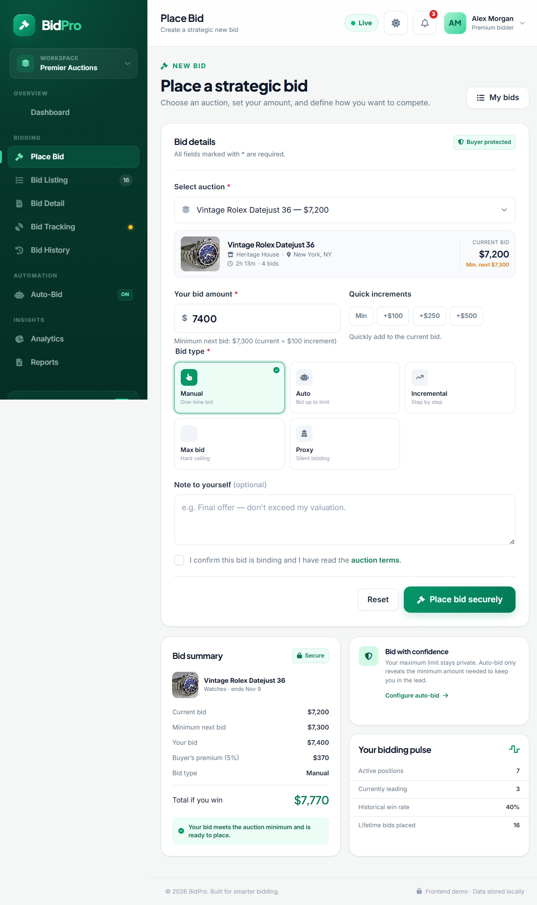 |
| Bid Listing | 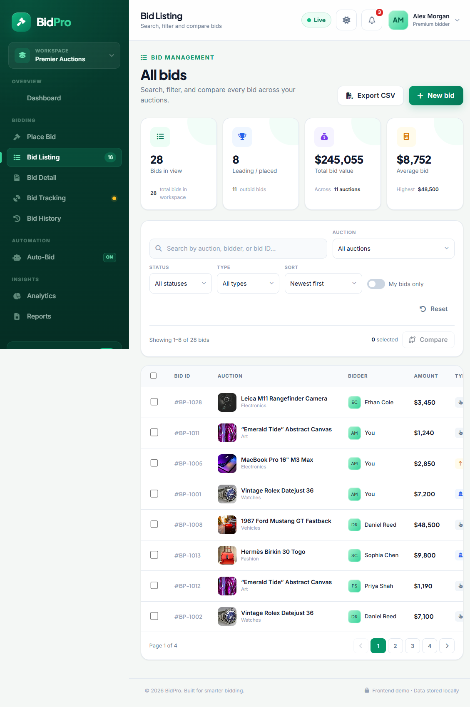 |
| Bid Detail | 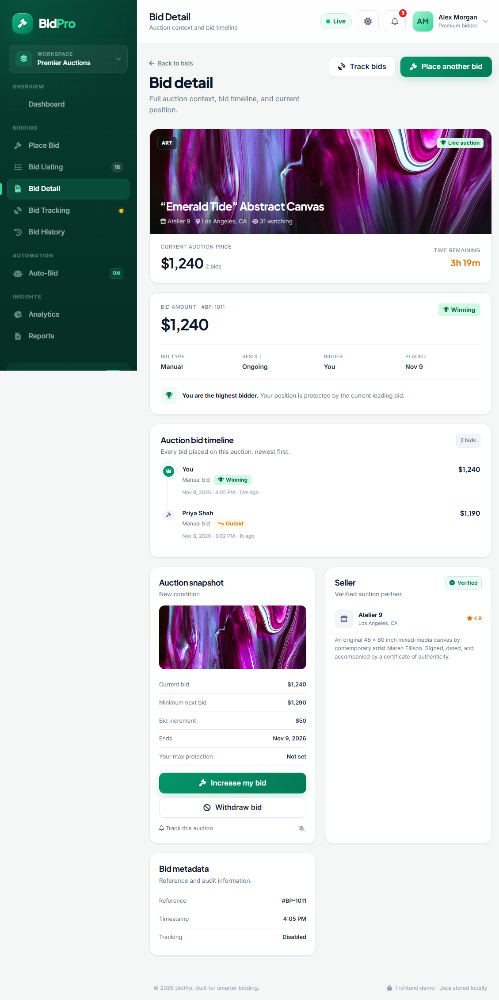 |
| Bid Tracking | 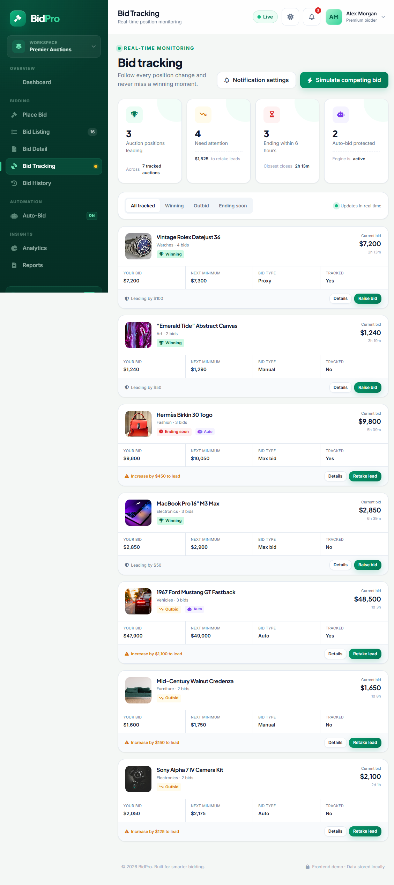 |
| Bid History | 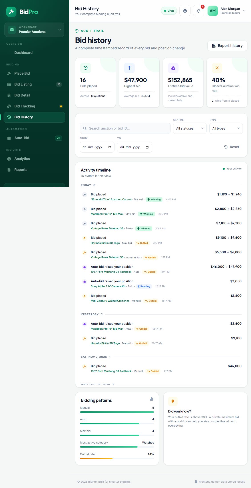 |
| Auto-Bid Settings | 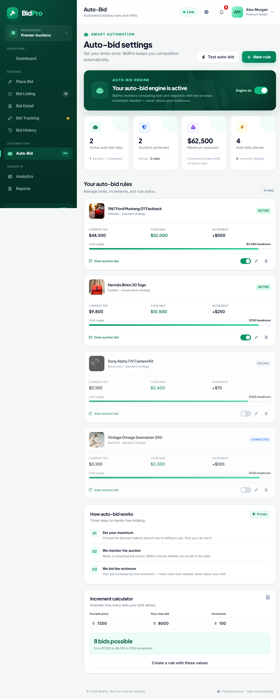 |
| Bid Analytics | 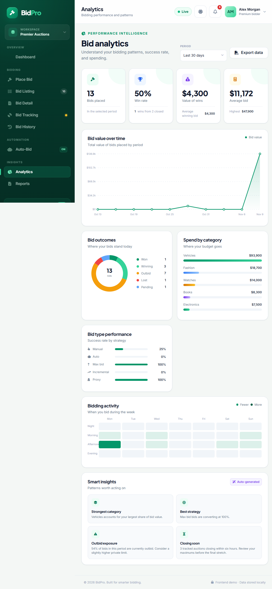 |
| Reports | 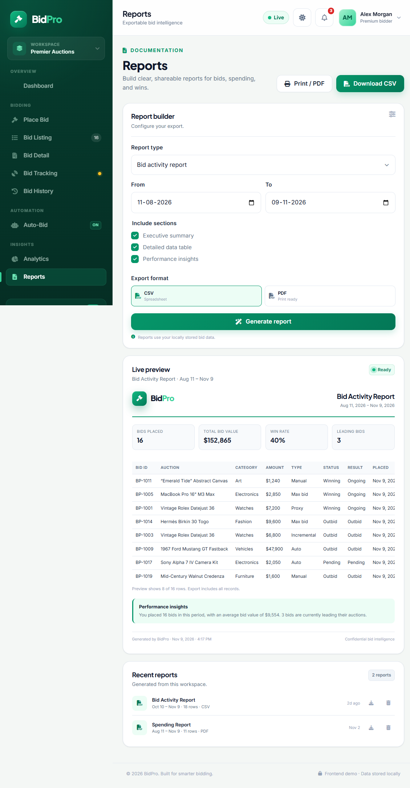 |
| Sign in | 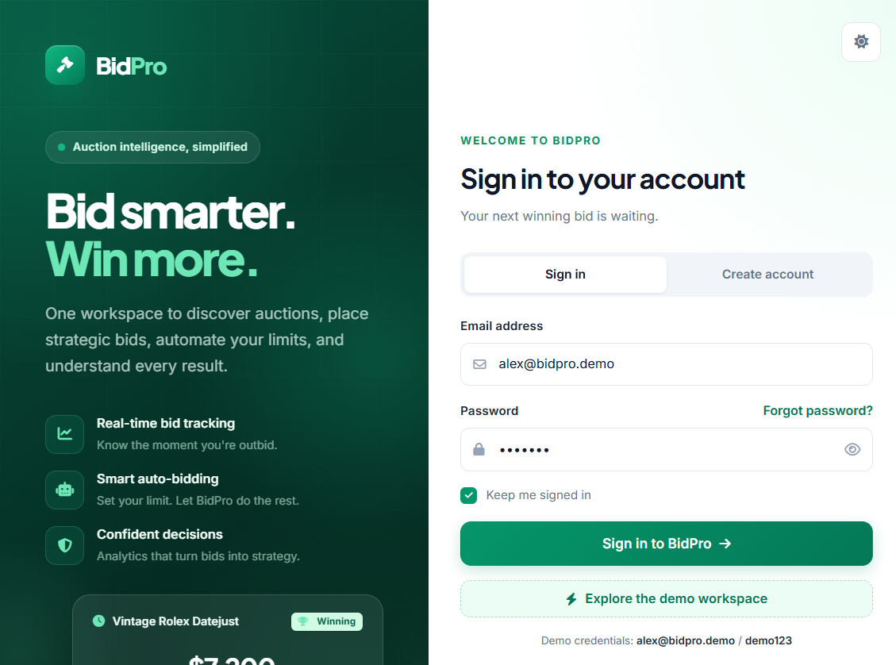 |
| Create account | 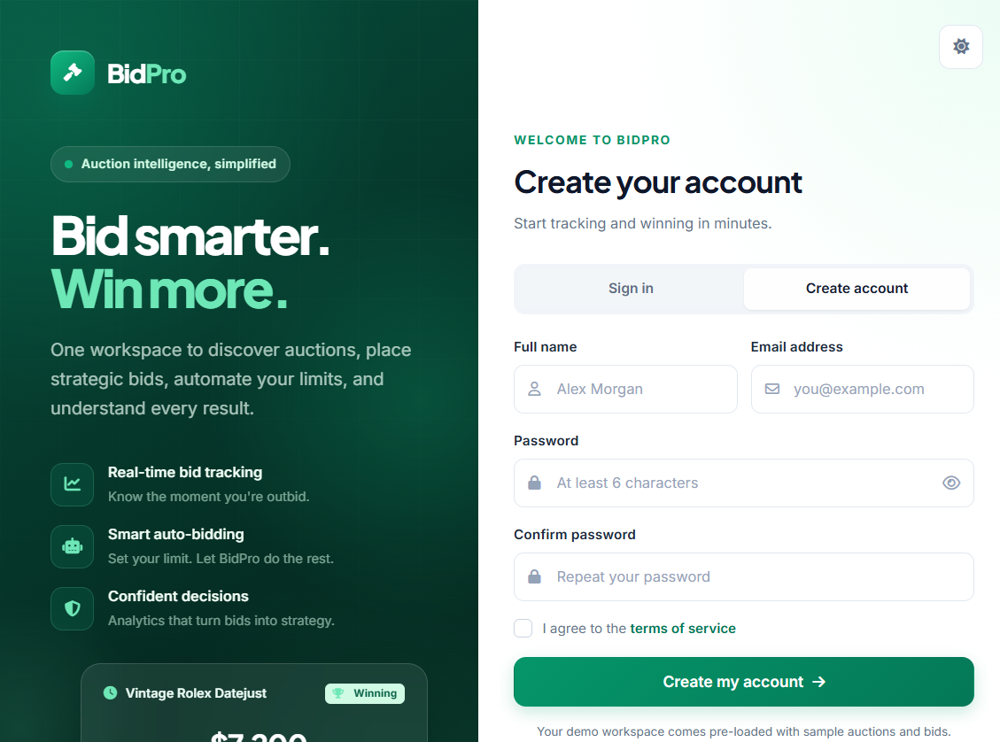 |
| Dark mode | 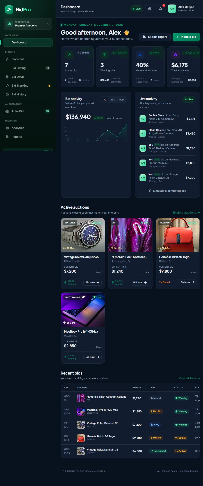 |
| Mobile view | 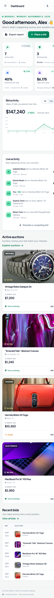 |

All screenshots live in [`screenshots/`](screenshots/).

---

## Features

### Authentication

- Sign in with validation and friendly error messages.
- Create account with name, email, password, confirmation, and terms checks.
- “Keep me signed in” session persistence via `localStorage`.
- Demo login shortcut.
- Sign out from the profile menu.
- Theme toggle available on both the auth screen and the app.

### Dashboard

- Personalised greeting and summary statistics.
- Live auction cards with countdown timers, current price, watchers, and status.
- Win-rate / spending / outbid overview.
- Recent activity feed and quick actions.
- Simulate a competing bid to watch live updates instantly.
- **Real-time simulation** adds competing bids on a timer while the app is open.

### Place Bid

- Auction selector with live preview (image, seller, location, countdown, current price, minimum next bid).
- Bid amount validation against the current price + increment.
- **Quick increment** chips: Min, +$100, +$250, +$500.
- Bid types: **Manual, Auto, Incremental, Max, Proxy** with conditional fields.
- Maximum bid and increment inputs.
- Private note field.
- Terms confirmation checkbox.
- Live bid summary: amount, buyer's premium, total, new position.
- Creates a bid, updates the auction price, marks the previous leading bid as outbid, records history, and navigates to the new bid's detail page.
- Optionally creates an auto-bid rule from an Auto/Max/Proxy bid.

### Bid Listing

- Paginated table of all bids.
- Search across auction, bidder, and bid ID.
- Filters for auction, status, type, and “my bids only”.
- Sorting (newest, amount, etc.).
- Status pills and result labels.
- Select multiple bids and **compare** them side by side in a modal.
- Responsive horizontal table scrolling on small screens.

### Bid Detail

- Full auction context with image, seller, location, watchers, and countdown.
- Current auction price and bid count.
- Bid amount, status, type, result, bidder, and placement date.
- Position explanation (winning / outbid / won / lost / pending).
- Complete auction bid timeline, newest first.
- Quick actions: track bids, place another bid.

### Bid Tracking

- Position-change timeline for active and recently closed auctions.
- Tracking statistics (leading, outbid, ending soon, etc.).
- Filters to focus on specific auctions or states.
- Clear visual states for winning and outbid positions.

### Bid History

- Complete timestamped record of every bid.
- Search and filter by auction, status, and type.
- Summary statistics and side panel insights.
- Outcome results: Winner, Runner Up, Outbid, Withdrawn, Ongoing.
- Export-ready data.

### Auto-Bid Settings

- Master auto-bid engine toggle.
- Create, edit, pause/resume, and delete auto-bid rules.
- Per-rule maximum amount, increment, and strategy.
- “Test auto-bid” simulation: a competitor bid triggers an automatic minimum-increment response, never above the maximum.
- **Increment calculator**: estimates how many bids a limit allows.
- Explanatory “how it works” steps.

### Bid Analytics

- Headline metrics: total bids, win rate, spend, average bid.
- Spending trend line chart (inline SVG).
- Outcome donut chart.
- Category performance bars.
- Bid-type performance rows.
- Activity heatmap (day × time).
- Automatically generated insights.
- Date-range filters.
- Fully responsive and theme-aware.

### Reports

- Report builder with report type, date range, and format.
- Five report types:
  - Bid Activity
  - Spending Summary
  - Winning Bids
  - Auction Performance
  - Auto-Bid Report
- Live report preview with summary boxes, data table, and insights.
- **CSV export** using a Blob download (proper quoting and UTF-8).
- **Print / PDF** view with a dedicated print stylesheet — choose “Save as PDF” in the browser dialog.
- Saved report history with type, format, row count, and generation date.
- Delete saved reports.

### Global & bonus features

- Simulated real-time competing bids (timer + manual trigger).
- In-app toast notifications.
- Notification centre with unread badge and “mark all read”.
- Global search that jumps to filtered bid results.
- Comparison modal for selected bids.
- **Dark mode** with persisted preference.
- Fully responsive sidebar, topbar, grids, and tables.
- Keyboard support: `Esc` closes modals/dropdowns, `/` focuses global search.
- Reset demo data from the profile menu.

---

## Tech stack

| Layer | Choice |
| ----- | ------ |
| Markup | Semantic HTML5 |
| Styling | CSS3 custom properties, Grid, Flexbox, media queries, print styles |
| Logic | Vanilla JavaScript (ES2015+, single IIFE) |
| Charts | Hand-built inline SVG and CSS — no chart library |
| Icons | Font Awesome 6 (CDN) |
| Fonts | Inter + Plus Jakarta Sans (Google Fonts) |
| Persistence | `localStorage` |
| Exports | Blob download (CSV), `window.print()` (PDF) |

No frameworks, bundlers, package managers, or server-side code.

---

## Project structure

```
BID MANAGEMENT SYSTEM/
├── index.html              # All pages, auth screen, modals, and static markup
├── style.css               # Design system, layout, themes, responsive + print styles
├── script.js               # Application state, routing, rendering, and interactions
├── assets/
│   ├── favicon.svg
│   └── images/             # Local auction thumbnails (10 images)
├── screenshots/            # Submission screenshots (13 PNG files)
├── README.md               # This file
└── PROJECT_REPORT.md       # Full project report for academic submission
```

---

## How it works

### Single-page application

`index.html` contains all page sections. Navigation uses **hash routing** (`#dashboard`, `#place-bid`, `#bids`, `#bid-detail?id=29`, …). A `hashchange` listener renders the matching section and updates the page title, sidebar state, and active link.

### State and persistence

The app keeps one state object:

```js
{
  user, users, auctions, bids, autoBids, history,
  notifications, savedReports, settings, next*Id counters
}
```

State is saved to `localStorage` under `bidpro_state_v4`. The session is stored under `bidpro_session_v4`, and the theme under `bidpro_theme`.

The demo starts from `seedState()`, which generates 11 auctions, 28 bids, 4 auto-bid rules, notifications, and saved reports. **Reset demo data** in the profile menu restores this seed.

### Bid lifecycle

1. Validate the amount against `current_price + min_increment`.
2. Mark the previous highest bid as `outbid`.
3. Create the new bid as `winning` with type, note, result, and timestamp.
4. Update the auction's `current_price` and `bid_count`.
5. Append an entry to the history log and notify relevant users.
6. Persist and route to the bid detail page.

### Real-time simulation

A timer places competing bids on active auctions at a fixed interval, and the **Simulate a bid now** button does the same on demand. Each simulated bid updates prices, statuses, tracking, analytics, and notifications in place.

### Auto-bid engine

For each active rule, when a competitor outbids the user, the engine places the smallest bid that regains the lead — `current_price + increment`, capped at `max_amount`. Rules can be paused, resumed, edited, or deleted. The engine can be disabled globally.

### Analytics

Charts are generated from the user's bids: SVG polyline for the spending trend, SVG donut for outcomes, CSS bars for categories, and a CSS grid heatmap for activity. Insights are derived from win rate, spend, and category/type performance.

### Exports

- **CSV**: builds a quoted CSV string, wraps it in a `Blob`, and triggers a download.
- **PDF**: injects a print-optimised report into `#printArea` and calls `window.print()`. The `@media print` rules hide the app and show only the report.

---

## Data model

### Auction

```js
{
  id, title, category, description, image,
  current_price, starting_price, min_increment,
  end_date, status, seller, seller_rating,
  location, condition, watchers, bid_count, featured
}
```

### Bid

```js
{
  id, auction_id, bidder_id, bidder_name,
  amount, max_amount, increment,
  bid_type,      // manual | auto | incremental | max | proxy
  status,        // placed | winning | outbid | won | lost | pending | withdrawn
  result,        // winner | runner-up | outbid | withdrawn | ongoing
  note, placed_at
}
```

### Auto-bid rule

```js
{ id, user_id, auction_id, max_amount, increment, status, strategy, created_at }
```

### Saved report

```js
{ id, type, label, format, from, to, rows, generated_at }
```

---

## Design system

| Token | Value |
| ----- | ----- |
| Primary green | `#059669` |
| White | `#FFFFFF` |
| Light green | `#D1FAE5` |
| Deep sidebar | Dark emerald gradient |
| Success / warning / danger | Emerald / amber / rose |

- **Typography:** *Plus Jakarta Sans* for headings, *Inter* for body text.
- **Surfaces:** soft cards, 12–20 px radii, subtle borders and shadows.
- **Motion:** short transitions on hover, menus, modals, and toasts; disabled under `prefers-reduced-motion`.
- **Themes:** light and dark, driven by `data-theme` on `<html>` and CSS custom properties.
- **Status colour language:** green = winning/won, amber = pending, red = outbid/lost, slate = neutral.

---

## Responsive behaviour

Verified at **390 px**, **768 px**, **1024 px**, and desktop widths.

- **≤ 900 px:** sidebar becomes an off-canvas drawer with a hamburger button, overlay, and close button; grids collapse; tables scroll horizontally inside `.table-responsive`.
- **≤ 1050 px:** multi-column layouts collapse to single column; sidebar narrows.
- **≤ 700 px:** auction grid becomes one column, profile text hides, page headings stack.
- **≤ 520 px:** compact spacing and typography.
- No horizontal page overflow at any tested width.

---

## Accessibility

- Semantic landmarks (`header`, `nav`, `main`, `aside`, `footer`).
- Visible focus styles and keyboard-operable controls.
- `aria-label`, `aria-expanded`, `aria-selected`, `role`, and live regions for toasts.
- Form labels, required markers, and inline validation messages.
- `Esc` closes modals and dropdowns; `/` focuses global search.
- Colour contrast designed for both themes.
- `prefers-reduced-motion` support.

---

## Browser support

Latest versions of Chrome, Edge, Firefox, and Safari. The app uses modern CSS (`:has`-free, Grid, custom properties) and ES2015+ JavaScript. No Internet Explorer support.

---

## Deployment

The project is a static site, so it can be hosted anywhere.

### GitHub Pages

```bash
git init
git add .
git commit -m "Add BidPro bid management system"
git branch -M main
git remote add origin https://github.com/<username>/<repo>.git
git push -u origin main
```

Then in the repository: **Settings → Pages → Source: Deploy from a branch → `main` / root**. Your app will be available at `https://<username>.github.io/<repo>/`.

### Netlify

1. Sign in to Netlify and choose **Add new site → Import an existing project**.
2. Select the repository.
3. Leave the build command empty and set the publish directory to `.` (or drag the project folder onto Netlify Drop).

### Vercel

1. Import the repository.
2. Framework preset: **Other**.
3. Build command: none. Output directory: `.`.

### Notes

- All paths are relative, so the app works from a subdirectory.
- `index.html` is the entry point.
- No environment variables or server configuration are required.

---

## Submission checklist

| Deliverable | Status / where |
| ----------- | -------------- |
| Source code | `index.html`, `style.css`, `script.js`, `assets/` |
| README | `README.md` |
| Project report | `PROJECT_REPORT.md` |
| Screenshots | `screenshots/` (13 images) |
| Demo video | Record a 3–5 minute walkthrough (see script below) |
| YouTube link | Upload the video as **Unlisted** or **Public** and paste the link here |
| Live deployment | Deploy with GitHub Pages / Netlify / Vercel and paste the URL here |

### Suggested demo video script (3–5 minutes)

1. **Intro (15 s)** — what BidPro is and the tech stack.
2. **Sign in (20 s)** — demo credentials and the auth screen.
3. **Dashboard (30 s)** — stats, live auctions, simulate a bid, notifications.
4. **Place Bid (45 s)** — select an auction, try an invalid low bid, then a valid bid; show validation and the new detail page.
5. **Bid Listing (30 s)** — search, filter, pagination, compare.
6. **Tracking & History (30 s)** — position timeline and timestamped record.
7. **Auto-Bid (45 s)** — create a rule, test the engine, use the increment calculator.
8. **Analytics (30 s)** — charts and insights.
9. **Reports (40 s)** — preview, download CSV, print/save as PDF.
10. **Dark mode & mobile (20 s)** — theme toggle and responsive drawer.
11. **Close (15 s)** — summary and live link.

Record at 1080p, keep the cursor visible, and narrate each step.

---

## Limitations & notes

- **Frontend-only:** there is no server, database, authentication service, or payment processing. All bids, auctions, and users are simulated.
- **Local data:** state is stored per browser profile. Clearing site data resets the app. Use **Reset demo data** to restore the seed.
- **Not real money:** no bid is binding and no payment is taken.
- **Shared demo workspace:** newly registered accounts use the same sample auction workspace as the demo user, since this is a single-user demo.
- **Icons and fonts** load from CDNs, so an internet connection is needed for the full visual experience. Images are local.
- **PDF export** uses the browser print dialog; choose “Save as PDF” as the destination.
- **Live simulation** continues while the app is open and may add bids between visits.

---

## Credits

- Auction photography: [Unsplash](https://unsplash.com) (downloaded locally for reliable offline display).
- Icons: [Font Awesome](https://fontawesome.com).
- Fonts: [Google Fonts](https://fonts.google.com) — Inter and Plus Jakarta Sans.

Built as a frontend demonstration project. © 2026 BidPro.
